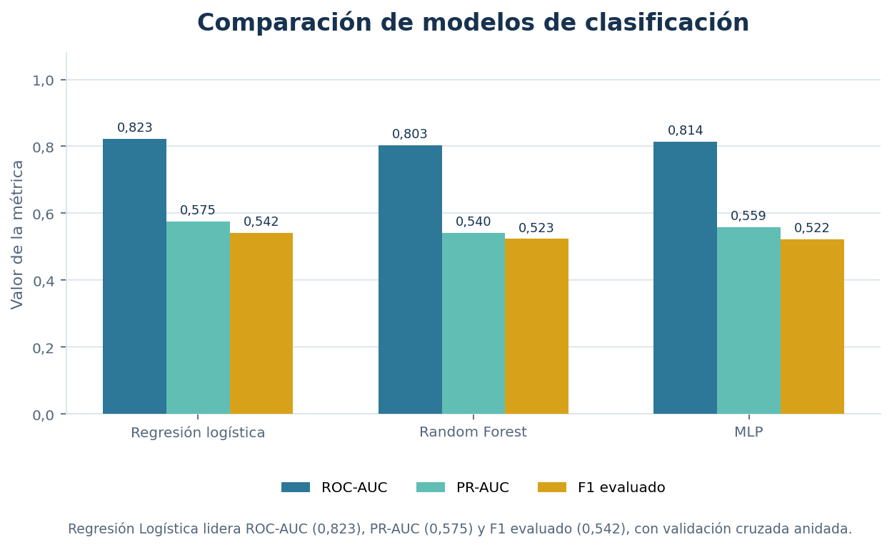

# Predicción de rotación de empleados

Proyecto educativo de Big Data y analítica de Recursos Humanos. Integra preparación de datos con PySpark, modelado con scikit-learn y visualización en Power BI para analizar una empresa hipotética y orientar sus prioridades de negocio.

## Alcance

- Control de calidad e integración de dos ficheros mediante ETL con PySpark.
- Comparación de Regresión Logística, Random Forest y MLP.
- Evaluación con validación cruzada anidada y selección de umbral sin contaminar el fold externo.
- Persistencia de características y predicciones en PostgreSQL.
- Visualización ejecutiva y análisis de prioridades en Power BI.

**Tecnologías:** Python, PySpark, scikit-learn, Jupyter, Docker Compose, PostgreSQL y Power BI.

## Entregables

- [Panel ejecutivo interactivo (HTML; funciona sin Docker ni Power BI Desktop)](docs/powerbi/Panel_Rotacion_Empleados_interactivo.html)
- [Archivo de Power BI Desktop (PBIX; instantánea anterior)](bi/Panel_Rotacion_Empleados.pbix)
- [Presentación del proyecto](docs/Presentacion_Proyecto_Rotacion.pptx)
- [Resultados finales verificados](docs/RESULTADOS_FINALES.md)
- [Memoria del proyecto (PDF)](docs/Memoria_Proyecto_Rotacion.pdf) · [versión HTML](docs/Memoria_Proyecto_Rotacion.html)
- Notebooks de análisis y documentación en `notebooks/`
- [Arquitectura](docs/arquitectura.md)
- [Procedencia de datos](docs/DATA_SOURCE.md)
- [Protocolo de modelado](docs/MODELING_PROTOCOL.md)

## Datos

El dataset principal contiene 1.470 registros y 35 variables del ejercicio de rotación. La procedencia y las limitaciones están documentadas en `docs/DATA_SOURCE.md`.

`encuesta_clima.csv` se genera con semilla 42 y cinco escalas aleatorias de 1 a 5, sin consultar la etiqueta de rotación.

## Pipeline canónico

La única ruta oficial para obtener las métricas y artefactos finales es:

```bash
docker compose up -d --build

docker compose run --rm jupyter python /scripts/generate_synthetic_survey.py \
  --input /data/raw/WA_Fn-UseC_-HR-Employee-Attrition.csv \
  --output /data/raw/encuesta_clima.csv --seed 42

docker compose run --rm jupyter python /scripts/check_data_quality.py \
  --input1 /data/raw/WA_Fn-UseC_-HR-Employee-Attrition.csv \
  --input2 /data/raw/encuesta_clima.csv \
  --key EmployeeNumber --max-null-frac 0.25

docker compose run --rm jupyter python /scripts/etl_attrition.py \
  --input1 /data/raw/WA_Fn-UseC_-HR-Employee-Attrition.csv \
  --input2 /data/raw/encuesta_clima.csv \
  --outdir /data/processed/employee_attrition.parquet

docker compose run --rm jupyter python /scripts/train_ml.py \
  --input /data/processed/employee_attrition.parquet --model all

docker compose run --rm jupyter python /scripts/load_features_to_pg.py \
  --input /data/processed/employee_attrition.parquet

for MODEL in LogReg RF MLP; do
  case "$MODEL" in
    LogReg) ART="/output/models/logreg_pipeline.pkl" ;;
    RF) ART="/output/models/rf_pipeline.pkl" ;;
    MLP) ART="/output/models/mlp_pipeline.pkl" ;;
  esac
  docker compose run --rm jupyter python /scripts/persist_results.py \
    --input /data/processed/employee_attrition.parquet \
    --model "$ART" --model_name "$MODEL" \
    --metrics_json /output/metrics/model_compare.json
done

docker compose run --rm jupyter python /scripts/render_dashboard_previews.py
```

La evaluación usa 5 folds externos y 3 folds internos para seleccionar el umbral. Las variables `survey_*` son sintéticas y se excluyen del entrenamiento; se conservan para recorrer la integración de los dos ficheros. Las métricas finales se generan de nuevo con `scripts/train_ml.py`. La persistencia posterior alimenta las tablas y vistas que utiliza el PBIX. No se deben copiar como definitivos valores históricos de versiones anteriores.

## PostgreSQL

El esquema reproducible está en `postgres/init/001_schema.sql`. Las credenciales y puertos se pueden configurar mediante `.env`, usando `.env.example` como plantilla.

Para persistir resultados:

```bash
docker compose run --rm jupyter python /scripts/load_features_to_pg.py \
  --input /data/processed/employee_attrition.parquet

docker compose run --rm jupyter python /scripts/persist_results.py \
  --input /data/processed/employee_attrition.parquet \
  --model /output/models/logreg_pipeline.pkl \
  --model_name LogReg \
  --metrics_json /output/metrics/model_compare.json
```

## Notebooks

Para regenerar sus HTML desde cero: `bash scripts/export_notebooks.sh`.

Los notebooks documentan el análisis. `02_Modelado_Baseline` y `03_Modelado_DL` muestran ejercicios exploratorios independientes; sus resultados no sustituyen la evaluación canónica de `scripts/train_ml.py`.

## Dashboard



Las figuras de `docs/powerbi/` resumen la evaluación OOF y las tasas observadas de Attrition. El panel interactivo HTML presenta los resultados canónicos con selector de modelo y abre directamente en un navegador, sin Docker ni conexión a bases de datos. El PBIX conservado en `bi/` es una instantánea anterior y no contiene los resultados canónicos actuales. Consulta [el estado y la guía del panel](docs/powerbi/REFRESCAR_PANEL.md).

## Reproducibilidad y calidad

- Dependencias Python fijadas en `requirements-ml.txt`.
- Versiones de Docker fijadas a tags concretos.
- Healthcheck de PostgreSQL antes de arrancar Jupyter.
- Tests unitarios en `tests/`.
- CI en `.github/workflows/ci.yml`.
- Salidas generables en `output/metrics`, `output/models`, `output/plots` y `output/bi`.

## Interpretación

Las puntuaciones y coeficientes sirven para ordenar preguntas de diagnóstico por área. Las tasas observadas, las señales OOF y el riesgo predicho por el modelo completo se presentan con sus etiquetas y denominadores para orientar el seguimiento de las medidas.
