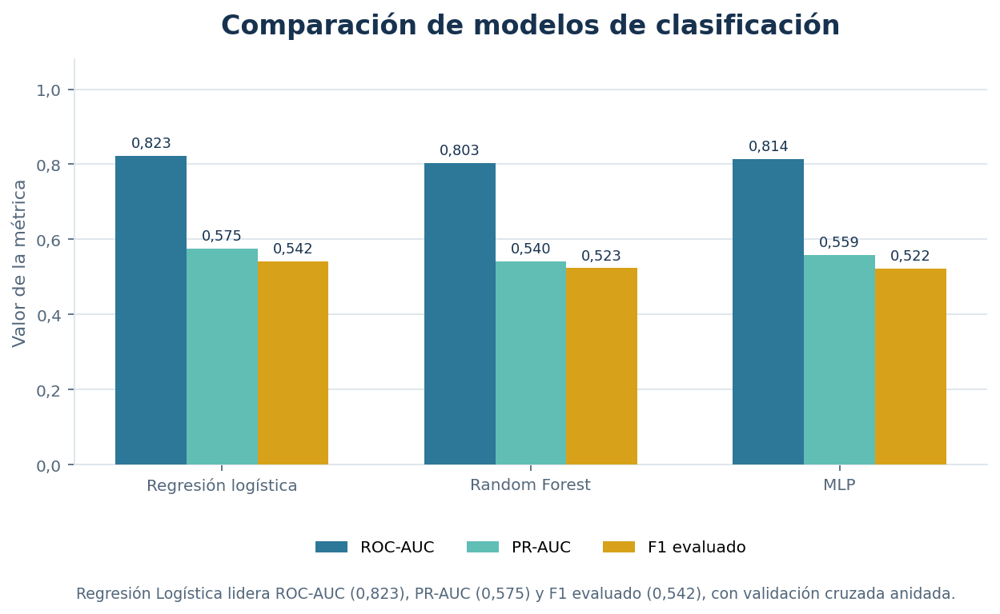
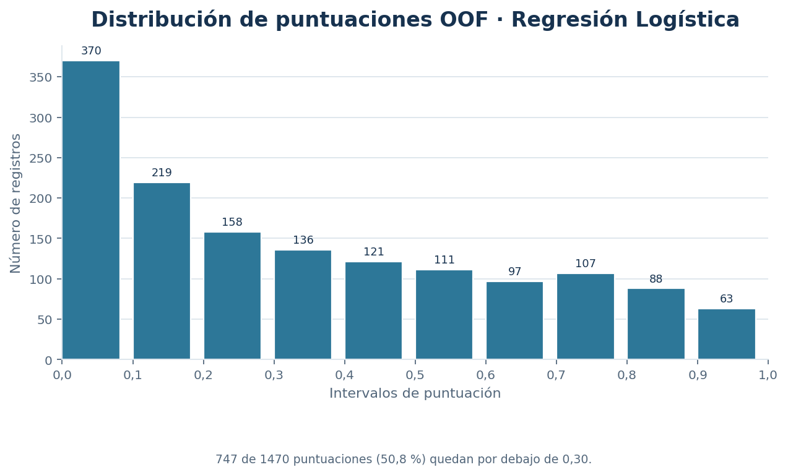
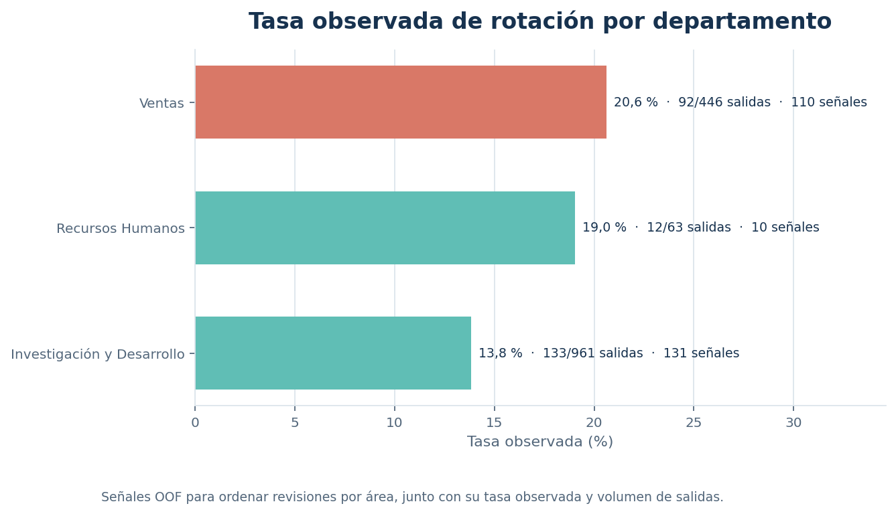
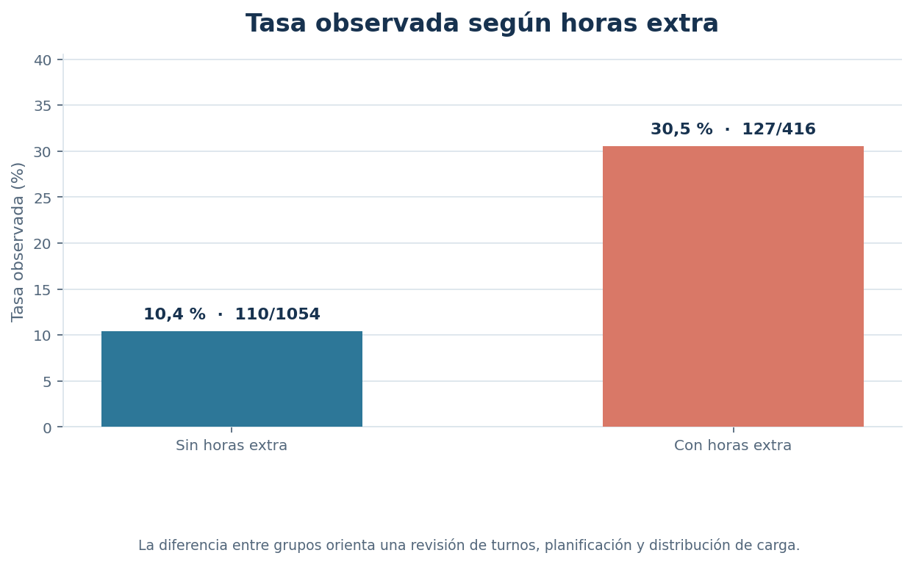
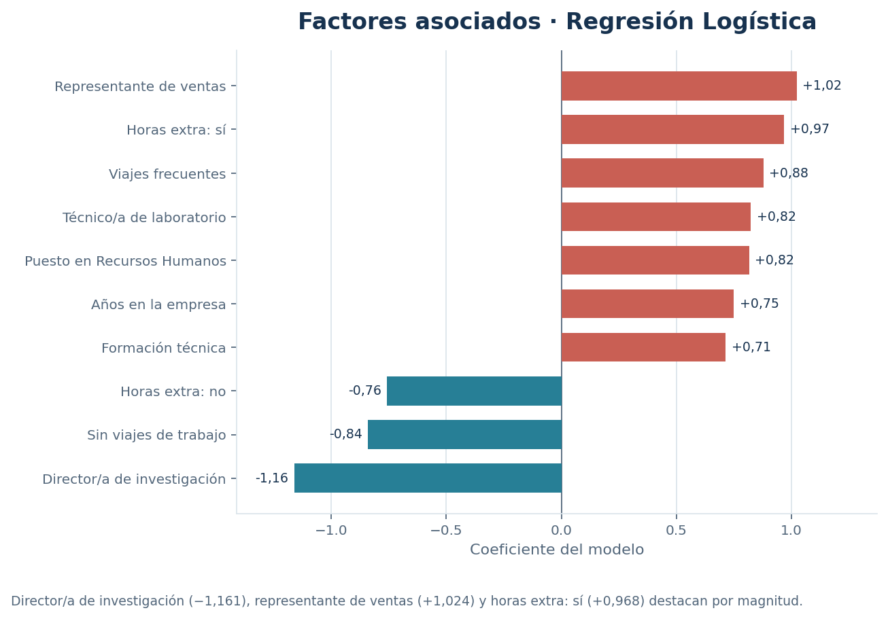

# Panel de rotación de empleados

Esta página muestra las gráficas directamente en GitHub. Haz clic en una imagen para verla a tamaño completo.

## Comparación de modelos

Compara ROC-AUC, PR-AUC y F1 evaluado para Regresión Logística, Random Forest y MLP. Regresión Logística obtiene los valores más altos en las tres métricas.

## Distribución de puntuaciones

Muestra cómo se distribuyen las puntuaciones OOF de Regresión Logística entre los registros.

## Rotación por departamento

Presenta la tasa observada, el número de salidas y las señales OOF de cada departamento para facilitar la comparación de sus tamaños y resultados.

## Rotación y horas extra

Compara las tasas observadas y sus denominadores para los grupos con y sin horas extra.

## Factores asociados al modelo

Muestra los coeficientes de Regresión Logística con mayor magnitud. Sus valores describen asociaciones del modelo.

[Consultar resultados y recomendaciones](../RESULTADOS_FINALES.md)

La versión HTML con selector de modelos se conserva como archivo descargable en esta carpeta: `Panel_Rotacion_Empleados_interactivo.html`.